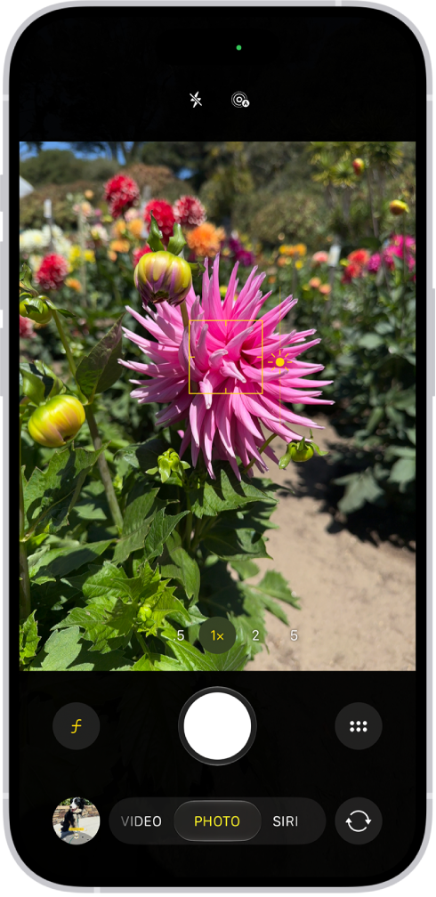
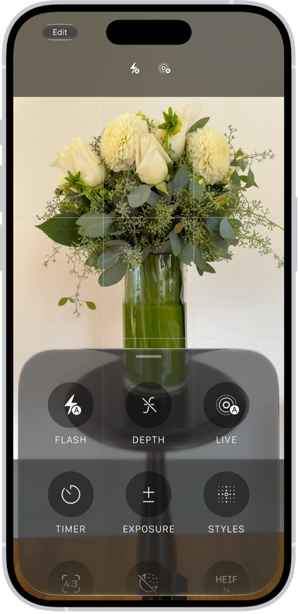
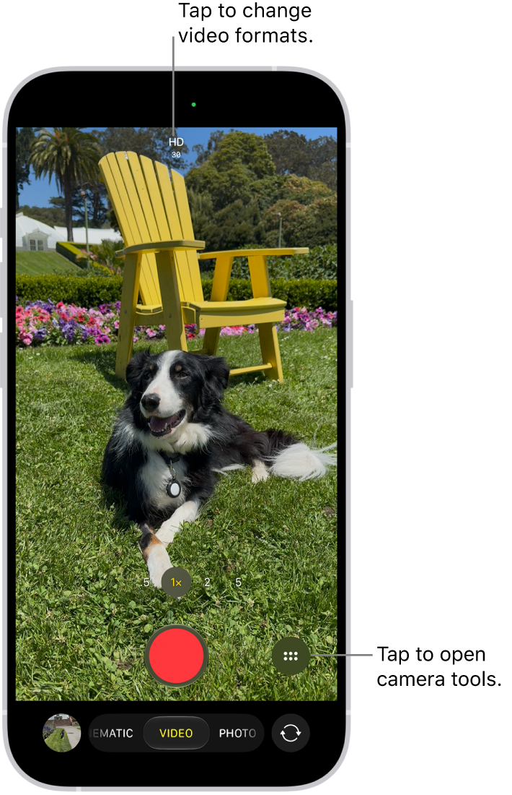
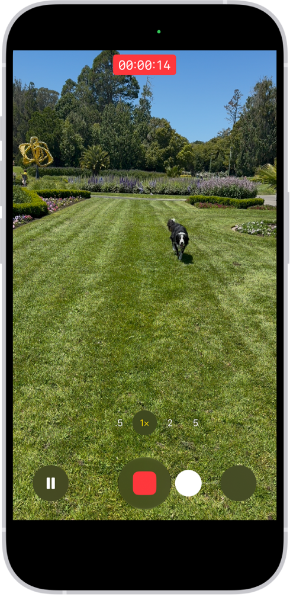
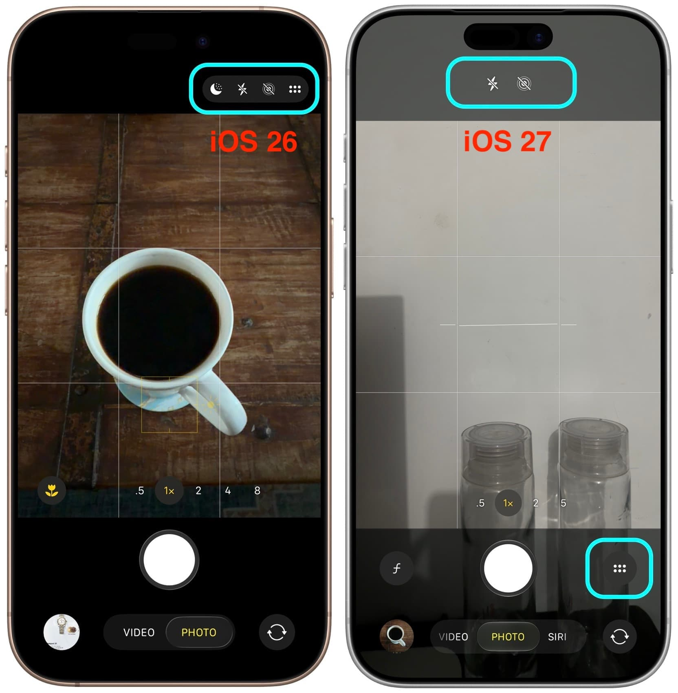
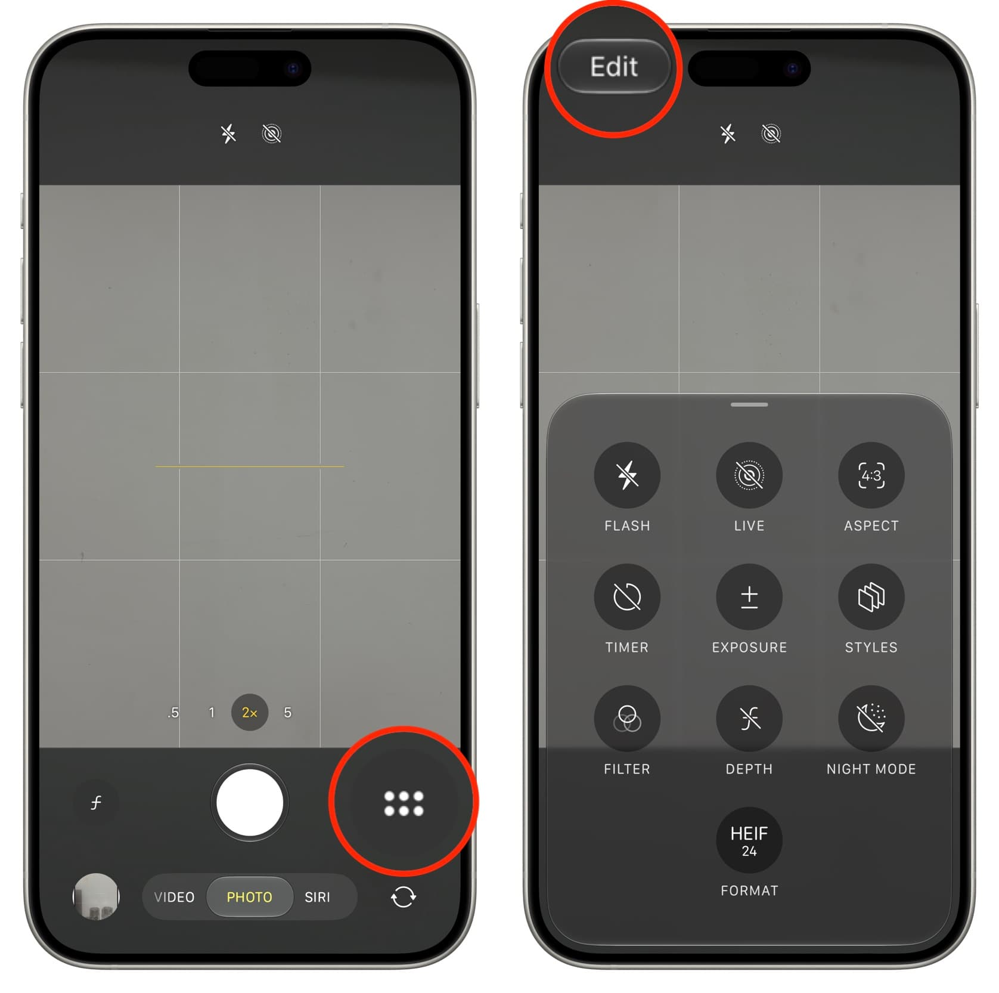
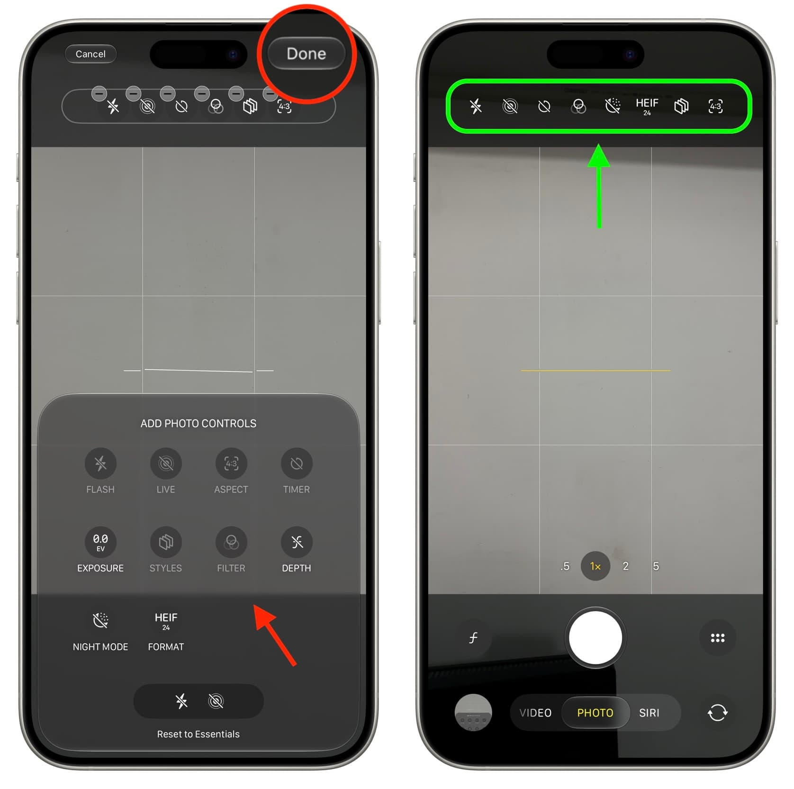
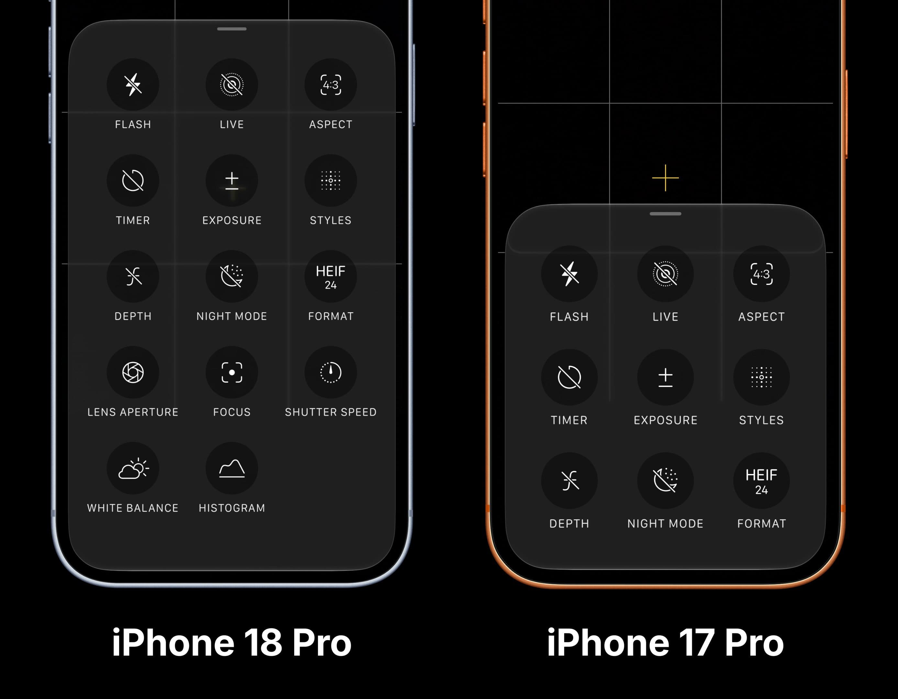

# Apple Camera: visual references

Research date: October 29, 2026.
Scope: iOS 27 Camera, with iOS 26 comparisons and device differences.
Analysis: [UI and UX research](iphone-camera-ui-ux.md).

Images below were downloaded unchanged from their publishers and visually inspected.
They are reference material, not newly designed screens or a working app.
Apple and the respective publishers retain rights to their images.
The surrounding publisher annotations are not part of the Camera app.

## Apple: focus and exposure in Photo mode

Observed: two centered top controls, a yellow focus rectangle and exposure glyph, zoom choices above the shutter,
a white shutter, a contextual depth control, a six-dot tools button, and a lower mode selector.
The illustration includes 5x and Siri, so it is not an exact iPhone 16 Plus layout for every region.

[Source article](https://support.apple.com/guide/iphone/use-camera-tools-iph3dc593597/27/ios/27).
[Original image](https://ipcdn-web.apple.com/assets/v2/web/3db30b2a-9f83-41ca-a7c3-addac75e14d6).

## Apple: tools sheet

Observed: a rounded translucent sheet, a drag handle, a three-column grid of labeled circular tools,
and an Edit button at the upper left.
The scene remains visible behind the sheet.

[Source article](https://support.apple.com/guide/iphone/use-camera-tools-iph3dc593597/27/ios/27).
[Original image](https://ipcdn-web.apple.com/assets/v2/web/78a40ff8-c83d-4552-90d8-9a2950835034).

## Apple: Video mode before capture

Observed: a red circular record button, visible format information, a tools button beside the record button,
and a bottom mode selector. This illustration also contains guide lines drawn by Apple to identify controls.
The image's published alternative text says the menu is at the top right, but the image visibly places it below.
This is a source inconsistency, not a separate layout verified in this research.

[Source article](https://support.apple.com/guide/iphone/record-a-video-iph61f49e4bb/27/ios/27).
[Original image](https://ipcdn-web.apple.com/assets/v2/web/d66d404d-2831-4e4d-a913-50145cdf4d70).

## Apple: recording state

Observed: elapsed time in a red field, a square stop glyph, a pause button, and a separate white still-photo button.
This is a recording illustration from the QuickTake section, not a frame-by-frame recording of the gesture.

[Source article](https://support.apple.com/guide/iphone/record-a-video-iph61f49e4bb/27/ios/27).
[Original image](https://ipcdn-web.apple.com/assets/v2/web/e06bdc1d-248f-440f-a7c9-a06b7e6de206).

## iDownloadBlog: iOS 26 versus iOS 27

Observed: the six-dot tools button moves from the upper group to the shutter area.
The iOS 27 side shows centered top essentials and a bottom mode strip with Siri.
The two devices also have different zoom labels; those differences are not caused only by iOS.

## iDownloadBlog: opening customization

Observed: open tools from beside the shutter, then choose Edit at the upper left.
Red circles are publisher annotations.

## iDownloadBlog: adding and pinning controls

Observed: selected top controls have removal badges in edit mode.
The lower sheet provides labeled choices. Cancel, Done, and Reset to Essentials provide exit and recovery paths.
Green arrows and outlines are publisher annotations.

## iDownloadBlog: controls vary by hardware

Observed: the iPhone 18 Pro panel contains additional manual tools.
Do not present this panel as the iPhone 16 Plus feature set.

All four publisher comparisons come from:
[iDownloadBlog, updated September 28, 2026](https://www.idownloadblog.com/2026/09/14/customize-camera-icons-iphone/).
Their original images are in the publisher's [September 2026 media directory](https://media.idownloadblog.com/wp-content/uploads/2026/09/).
The filenames of the local copies match the original filenames.

## Evidence limits

These are selected published states, not an exhaustive recording of the app.
Exact point sizes, hit targets, haptics, landscape behavior, and animation timing were not measured.
No screenshots were generated to fill missing evidence.
