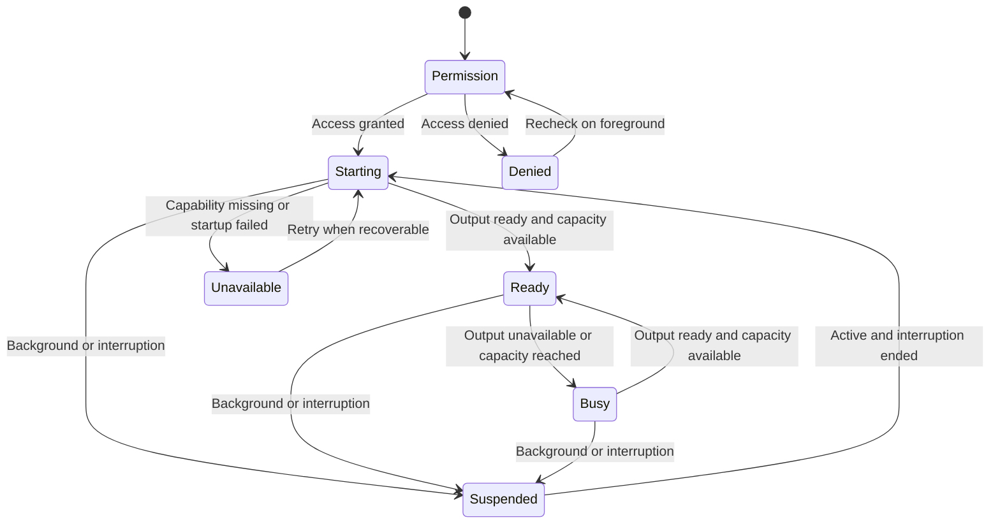

# Street camera MVP

Status: Implementation proposal  
Date: October 29, 2026  
Reviewed: October 30, 2026  
Primary test device: iPhone 16 Plus  
Priority: Capture speed, reliable storage, and a simple interface

Implementation authority: [First native MVP: Grip street camera](0002-first-native-mvp.md).
That specification governs the first native build and supersedes conflicting capture details below.
This document retains the broader proposal and the later look milestone.

## 1. Outcome

Build a minimum viable product (MVP) for taking street photographs with minimal interaction.
The user opens the app, frames a scene, and captures a still photograph.
They can lock focus in advance and take several photographs without reopening controls.
Each saved photograph retains its original raw data.

The first milestone proves capture and storage on a physical phone.
A second milestone adds one photographic look after the first milestone passes.
The capture milestone must work independently of the portable look renderer.

This specification defines a camera client alongside [RFC 0001](../rfcs/0001-portable-photographic-looks.md).
It does not change that RFC's portable format or expand its import-only MVP implicitly.
The camera client supplies originals that a compatible raw adapter can later develop.

The user has confirmed stills, one standard main camera, simplicity, and capture speed.
Raw-only storage, focus lock, and the two milestones are proposed implementation choices.
Validate their cost during the capture prototype; they are not additional user-confirmed constraints.

## 2. Scope

### Capture milestone

| Included | Required behavior |
|---|---|
| One camera | Physical rear standard main camera |
| Fixed framing | Main camera at 1x throughout capture |
| Stills | One photograph per accepted shutter action |
| Raw capture | Standard Bayer raw saved as Digital Negative (DNG) |
| Automatic focus | Continuous autofocus by default; tap to choose a focus point |
| Focus lock | Prefocus with a long press, then capture without restarting autofocus |
| Exposure | Automatic exposure, with contextual exposure compensation |
| Capture feedback | Immediate acceptance feedback; explicit busy and failure states |
| Storage | App-private originals and capture metadata |
| Review | View saved photographs, inspect detail, and return to capture |
| Original sharing | Share the original DNG through the system share sheet |
| Physical shutter | Use supported volume-button and Camera Control capture events |
| Diagnostics | Record capture timing, outcomes, and the actual configuration |

### One-look milestone

Add one versioned Dense monochrome profile in review, with a base-render comparison and JPEG export.
Keep the profile's name and its interpretation separate from any claim of reproducing a photographer's work.
The camera remains available while optional rendering work is suspended or deferred.

### Deferred

Video, audio, front camera, ultra-wide camera, zoom, automatic lens switching, and mode selection are outside this MVP.
Also defer burst gestures, calibrated distance presets, focus peaking, levels, and composition scoring.
Defer a live styled preview, a five-look selector, grain sliders, contact sheets, and image import.
Defer accounts, network services, synchronization, automatic Photos export, and a locked-camera extension.
Launching from a hardware button while the app is closed requires separate extension work.

Include an optional 3×3 grid, approved by the user after the Grip review.
Default it to off and remember the preference across launches.
Place its switch in More. Use thin lines with light and dark contrast over the image.
The grid must not intercept focus gestures, change framing, or appear in saved photographs, review, or exports.
The clean screen remains the initial baseline.

## 3. Platform and capability checks

Implement a native iOS application using Swift and AVFoundation.
Use iOS 18 as the proposed minimum deployment target.
Validate the first capture milestone on an iPhone 16 Plus running a recorded operating system build.
Run minimum-version checks before claiming compatibility across the supported operating system range.

Select `.builtInWideAngleCamera` with position `.back`.
Apple uses this API name for the standard main camera.
It does not mean `.builtInUltraWideCamera`.
Set `videoZoomFactor` to `1.0` and prevent user gestures from changing it.
Do not substitute a virtual dual-camera device.

Connect the device input and photo output before querying raw support.
Require an available Bayer raw format and supported autofocus and focus-lock behavior.
Record actual delivered dimensions. Do not assume 48-megapixel Bayer raw from the sensor specification.
Use the ordinary supported raw resolution initially; do not add 24- or 48-megapixel selection controls.

If a required capability is unavailable, show an unsupported-device state.
Do not silently switch camera, capture format, or framing.

Apple documents the raw workflow and the need to inspect connected output capabilities. [Raw capture guide][A1]

## 4. Main screen

Selected visual direction: Grip, confirmed by the user on October 30, 2026.
Use a quiet dark frame, a larger shutter on the lower right, and review access on the left.
The refined prototype places the return-to-camera control at the shutter position during review.
That control returns to capture without requesting a photograph.
See the [prototype decision notes](../research/street-camera-interface-prototypes.md).

```text
                                      ...


                Live view

          [Focus locked, when active]


  [last saved photo]              ( SHUTTER )
```

The diagram defines hierarchy, not pixel measurements.
Respect the safe areas and keep the shutter in a stable, reachable location.
Show the complete capture framing, with unused screen space outside the image when necessary.
Do not fill the display by silently cropping the viewfinder or saved photograph.
Keep controls outside the image where possible.
Record orientation for each accepted capture and apply it once during review and export.
Use a shutter touch target of at least 64 by 64 points.
Other interactive controls must have touch targets of at least 44 by 44 points.
These dimensions are proposed product requirements.

| Element | Interaction |
|---|---|
| Viewfinder | Tap to focus; long press to prefocus and lock |
| Exposure control | Appears beside a selected focus point; vertical movement changes compensation |
| Shutter | Tap to request one still photograph |
| Last saved thumbnail | Open review; hidden or disabled before the first saved photograph |
| Focus locked indicator | Visible only while verified locked; tap to restore automatic focus |
| More | Toggle the grid; open capture information and diagnostic export |

The initial preview is the ordinary camera preview.
It does not promise the final raw development or the later monochrome look.
The one-look milestone adds a quiet Dense monochrome label with explanatory information, without a look picker.
The label must explain that the look appears in review.

Do not require a session name, look choice, settings screen, or tutorial before the first capture.
Request camera permission when the user first opens the capture experience.
If permission is denied, provide an explanation and an action to open system settings.

## 5. Capture interaction

1. Open directly into the camera after required permission is granted.
2. Display the shutter as available only when the session can accept a capture.
3. Accept a tap or supported hardware shutter event.
4. Assign a capture identifier and request one raw photograph.
5. Keep the viewfinder visible while the result is delivered and stored.
6. Update the thumbnail when storage commits successfully.

Give brief haptic or visual feedback when the request is accepted.
Acceptance feedback does not mean that storage has completed.
Do not open review automatically.
Do not block a new eligible capture while building a thumbnail or applying a look.

Coalesce duplicate event delivery for the same physical button action.
Configure exactly one capture phase for each hardware interaction.
A held button must not start video or create an unbounded burst.

Keep accepted captures bounded. Start with at most two occupied capture slots.
Reserve a slot before issuing the request.
Keep it occupied through delivery and saving, until commit or a terminal failure releases its data.
A failed write with retained data still occupies its slot until retry succeeds or the data is explicitly discarded.
Retry storage using the same identifier and bytes; never take another photograph as a retry.
A delivery callback alone does not release capacity.
Use a lower limit when device readiness or memory pressure requires it.
This limit is a resource policy, not a promise that the phone can overlap two exposures.
Do not retain rejected taps for delayed execution after the moment has passed.
When busy, show a short readiness indication and record rejected attempts in diagnostics.

Accept capture input only while the camera screen is visible, the app is active, and readiness permits it.
Review, More, and the share sheet must not trigger hidden photographs through hardware input.
A busy shutter remains visibly unavailable; input handling records attempts without scheduling them.

## 6. Focus and exposure

### Automatic focus

Start each newly created camera session in continuous autofocus.
A tap sets a point of interest using the preview's coordinate conversion.
Show a temporary focus marker.
After the one-shot focus operation settles, explicitly restore continuous autofocus.
A long press takes precedence over a tap and must not also trigger the tap action.
Use a visible exposure control as the drag target; dragging elsewhere does not change compensation.

### Prefocus lock

1. The user long-presses a point in the viewfinder.
2. The app requests autofocus at that point and shows Focusing.
3. After focus settles, the app locks the current lens position.
4. Show Focus locked only after the lock operation completes and the state is verified.
5. Preserve that lens position through later captures and review.
6. Tapping Focus locked returns to continuous autofocus.

Use a two-second focus-acquisition timeout as an initial interaction requirement.
If focus fails, times out, or the session is interrupted, return to autofocus and remove the pending lock indicator.
Show a brief explanation instead of claiming that focus is locked.
Focus settling confirms actuator behavior, not subject sharpness.
Cancel earlier focus operations when a newer request or session change occurs.
Ignore stale completions so they cannot restore an obsolete lock indicator.
A long press while locked starts a new prefocus operation.
While acquiring a lock, capture remains available when the photo output is ready.
A shutter action captures using the current focus state; it does not wait for the lock request to finish.

While locked, ordinary viewfinder taps must not silently restart autofocus.
Expose contextual exposure adjustment without changing the locked lens position.
Focus lock does not lock exposure or white balance.

Return from review without changing a valid lock if the camera session remains active.
After a session restart or app relaunch, return to automatic focus and show that state.
Do not reuse a stored actuator value while presenting it as a verified distance.

The interface calls this feature Focus lock.
Calibrated zone focus and near/far distance scales are deferred.
Apple states that normalized lens positions do not map to consistent physical distances. [Lens position][A2]

### Exposure

Use automatic exposure and automatic white balance.
Exposure compensation uses the device's supported range and shows its current value when adjusted.
Provide an explicit reset to zero.
Retain compensation while reviewing and during an active capture session.
Reset to zero after app relaunch for the initial MVP.
During the same app run, restore compensation after session recreation before enabling capture.
If restoration fails, show the actual value and a brief explanation.
A tap changes the focus point only; it does not change the exposure metering point.
While locked, a tap reveals compensation without moving the lens.
Keep nonzero compensation visible as a small value with an accessible reset action.

Use supported photo quality prioritization with capture speed as the product priority.
The initial configuration should use `.speed`; record it in every performance run.
Changing quality prioritization later requires repeating capture and image-quality checks.

## 7. State model

Camera readiness and per-photo storage progress are separate state machines.
A photo saving in the background does not necessarily make the camera busy.



Screen navigation is separate from camera readiness.
Returning from review does not force Ready; recheck session, output, storage, and capacity first.
Keep a valid session during short review visits when the system permits it.
Stop capture input on backgrounding or interruption and recover without requiring an app relaunch.
Finish delivered writes within available execution time; do not promise unlimited background execution.
Mark incomplete capture outcomes explicitly and never replay a shutter action after recovery.

Each accepted capture progresses through Requested, Delivered, Saving, and Saved.
Capture errors end in Failed; write errors enter Save failed with retry while data remains available.
A retry returns to Saving. Lost or explicitly discarded data ends in Failed.
After restart, an attempt without recoverable data has an Unknown or interrupted outcome, never a false Saved outcome.
Look rendering has independent Pending, Rendering, Ready, and Failed states in the second milestone.
A rendering failure must not convert a saved original into a failed capture.

## 8. Original storage and recovery

Use app-private durable storage for originals and metadata.
Do not request microphone, location, or Photos library access for the capture milestone.

Store a logical capture bundle with:

| File or field | Purpose |
|---|---|
| `original.dng` | Original raw bytes returned by capture |
| `capture.json` | Schema version, identifier, request order, time, orientation, device, dimensions, and delivered capture metadata |
| `preview.jpg` | Regenerable review image; creation is not required for the original commit |
| Recipe reference | Reserved for the second milestone's versioned rendering choices |

Use unique capture identifiers and never overwrite an earlier original.
Record requested settings separately from metadata reported by the delivered photograph.
Do not represent a preview reading as a measured exposure value.
Use durable application storage, not a cache or temporary directory, for committed bundles.
The app must explain in review that deleting the app removes its local library; sharing preserves external copies.
Write the original and metadata into a staging directory.
Commit a complete bundle with an atomic rename on the same filesystem.
Update the library index and latest thumbnail only after that commit succeeds.
The index must be rebuildable from committed bundles.
Generate cached previews afterwards.
Keep the latest thumbnail tied to request order, not callback or commit order.
If the latest committed image has no preview yet, show a placeholder that still opens review.
A slow earlier capture must not replace the thumbnail of a later saved capture.

The required recovery guarantee covers process termination after a bundle commits.
It does not promise recovery from every power failure or from interruption before the camera delivers a complete raw file.
On launch, reconcile committed bundles and incomplete staging directories.
Retain complete recoverable originals; do not delete a valid original merely because its preview is missing.
Validate staging files before recovery; isolate incomplete or unreadable files instead of displaying them as saved.
Reconciliation must be repeatable without creating duplicates.
If metadata is missing, recover only known fields and mark unavailable fields as unknown.

On storage failure, keep any delivered original available for retry while the process can retain it.
Stop accepting additional captures when storage cannot safely accept them.
Show that the photograph is not saved and offer retry.
Before an explicit discard, state that the unsaved photograph will be lost and require confirmation.
Do not offer discard for a committed original in this milestone.
Do not label a preview as a saved photograph after an original write fails.

## 9. Review and sharing

The thumbnail opens the most recent committed photograph.
Swipe horizontally to move through saved photographs in request order, independent of save completion order.
Provide pinch inspection, a Share original action, and a stable return-to-camera action.
Pinch affects review magnification only; it never changes capture framing.

Review first uses an embedded preview when suitable or a background raw development.
Show a lightweight Preparing preview state when no image is available; keep original sharing available.
A preview failure offers retry and does not hide the saved original.
Any temporary preview must be replaced by a clearly identified final review image when ready.
Preserve original bytes and metadata when sharing the DNG.
Do not claim that a shared embedded preview contains the raw data.

Deletion, ratings, contact sheets, batch operations, and detailed editing are deferred.
Capture information can remain in More so the main screen stays simple.

## 10. One-look milestone

Begin only after the capture acceptance checks pass.
Integrate one Dense monochrome profile using the applicable contracts from RFC 0001.
Choose and freeze the raw adapter, base transform, profile revision, and renderer version before acceptance.
The profile remains an experimental interpretation until its visual review passes.

The following behavior is required:

- Capture always preserves the original DNG.
- Review applies the selected version of the profile.
- A Base/Look control compares the shared base rendering and the monochrome result.
- The comparison does not use the camera's embedded preview as the shared base.
- Save a recipe with the exact profile reference, development choices, and grain seed.
- Export a full-resolution JPEG with an embedded sRGB color profile.
- Preserve capture time and omit location metadata from the rendered export by default.

sRGB identifies the standard output color space used by the look RFC.
JPEG means Joint Photographic Experts Group.
Use the same rendering operations and parameters for final review and export.
Provide a full-resolution detail view to inspect grain and edge artifacts.

Expose no look-strength, grain, contrast, or white-balance sliders in this milestone.
Use explicit profile defaults and as-shot white balance.
Keep manual per-image rendering controls in the separate renderer workflow until field testing justifies them here.

Use at most one expensive rendering task at a time.
Suspend or cancel regenerable rendering work when capture needs resources.
Prioritize saving delivered originals over look rendering and export preparation.
Failed rendering retains the original and recipe and offers retry.

## 11. Implementation boundaries

| Component | Responsibility |
|---|---|
| Capture service | Own the session, physical camera, readiness, shutter events, and focus state |
| Capture store | Commit originals and metadata; reconcile storage after restart |
| Preview service | Generate bounded, regenerable review images |
| Review model | Navigate committed captures and share originals |
| Look adapter | Connect a capture to the portable renderer in the second milestone |
| Diagnostics | Record timing and outcomes without recording image pixels |

Keep capture session configuration and startup off the main thread.
Serialize configuration changes through one owner.
Use separate bounded work for storage and optional rendering.
Do not delay the shutter for source hashing, thumbnail generation, or look processing.
Compute recipe hashes after storage when required by the rendering contract.
Retain photo delegates until their requests complete.
Bound preview caches and diagnostic logs as well as capture and rendering queues.
Diagnostic export is a local, user-initiated action. Include capture identifiers, not images or source file paths.

Apple's AVCam sample demonstrates session ownership and off-main-thread capture work. [AVCam][A3]

## 12. Performance evidence

Record the phone model, operating system build, app build, capture format, dimensions, quality priority, and focus mode.
Use a monotonic clock for application timing.

| Measurement | Definition |
|---|---|
| Cold start | Launch instrumentation to first available capture state |
| Warm resume | Foreground activation to first available capture state |
| Request overhead | Shutter handler entry to the capture request call |
| Capture timing | Shutter event to the platform capture callback; label this as a proxy |
| Repeat interval | Time between accepted requests under a recorded tapping cadence |
| Storage latency | Raw delivery to committed capture bundle |
| Rejected attempts | Shutter attempts declined because readiness or capacity is unavailable |
| Failures | Accepted requests that end in a capture or storage failure |

Do not label a callback measurement as exact shutter-to-exposure latency.
Use a repeatable visual timing target if precise exposure timing is needed.
Report median and 95th-percentile results for repeated measurements.
Record peak memory, thermal state, and preview stalls during sustained capture.

Proposed implementation targets are:

- Shutter handlers return without waiting for focus, storage, thumbnails, or rendering.
- The 95th-percentile request overhead is at most 50 milliseconds on the primary test device.
- The 95th-percentile acceptance feedback begins within 100 milliseconds of an accepted input.
- Adding the look milestone increases median request overhead by no more than 10 milliseconds under the same test conditions.

These are design targets, not measured results.
Use at least 100 accepted captures for capture percentiles and 20 runs for each startup measurement.
Report sample counts, rejected attempts, and failures alongside timing results.
Repeat the same workload with optional rendering idle and active.
Include normal daylight and low light; record thermal conditions and available storage.

Set numerical startup and sustainable capture-rate gates from the first physical-device baseline.
Record the gates before running milestone acceptance; a baseline alone does not establish acceptable performance.
Set a minimum acceptance rate at the chosen cadence and a maximum storage backlog duration.
A run cannot pass solely because rejecting most inputs makes accepted requests fast.
The capture milestone remains incomplete until these gates are recorded and met.
If a target fails, reduce optional work before adding interface controls.

## 13. Acceptance checks

### Capture milestone

| ID | Scenario | Pass condition |
|---|---|---|
| C1 | First launch, permission denied or granted | Correct state; granting access reaches the camera without a setup form |
| C2 | Inspect capture configuration | Rear physical main camera, 1x, Bayer raw; no other camera or format substitution |
| C3 | Tap focus and prefocus lock | Lock is shown only after confirmation; later capture keeps focus locked while exposure remains automatic |
| C4 | Focus timeout, interruption, or session restart | No stale lock indicator; autofocus is restored and accurately displayed |
| C5 | On-screen and hardware shutter input | One accepted action produces one capture identifier and at most one original |
| C6 | Two 50-attempt sequences, one per second and two per second | Accepted, busy, and failed outcomes reconcile; after settling, every successful capture has one committed original |
| C7 | Inspect every successful file | Each DNG opens, reports actual dimensions, and matches its capture metadata |
| C8 | Terminate after storage commit, then reopen | All committed originals reappear; missing previews regenerate |
| C9 | Inject a write failure | No false saved state; new capture stops when storage is blocked; retained data supports retry |
| C10 | Review and return | Capturing resumes without an unwanted camera, zoom, or valid focus-lock change |
| C11 | Orientation and accessibility | Preview taps map correctly; review orientation is correct; controls expose labels and states |
| C12 | Export an original | Shared DNG bytes match the committed original |
| C13 | Inspect queues and diagnostics | Slots remain occupied through saving or retained write failures; caches and logs stay bounded; no image pixels or source paths in diagnostics |
| C14 | Background, interrupt, then resume | No hidden or replayed capture; delivered writes recover where complete; readiness is rechecked |
| C15 | Delay callbacks and repeat focus gestures | Stale focus completions are ignored; request order controls review and the latest thumbnail |
| C16 | Inject staging and preview failures | Recovery creates no duplicates; incomplete files are isolated; saved originals remain shareable without previews |
| C17 | Measure speed and framing | Recorded performance gates pass with acceptance rates reported; full framing and saved orientation match the viewfinder |
| C18 | Toggle the composition grid | Off on first launch; preference survives relaunch; focus and capture still work; grid is absent from review and exports |

The fixed tapping cadences expose backpressure. They are not promises that every attempt is accepted.
Record acceptance rates and rejection reasons so the cadence cannot conceal poor performance.

### One-look milestone

| ID | Scenario | Pass condition |
|---|---|---|
| L1 | Render a saved photograph | Look is monochrome; original bytes remain unchanged |
| L2 | Reopen a saved recipe | Same resolved profile and settings are used; unsupported versions produce an explicit error |
| L3 | Compare review and export | Same operations and parameters; full-resolution detail has consistent grain coordinates |
| L4 | Capture while rendering | Capture remains available according to readiness; queues and memory stay bounded |
| L5 | Fail rendering or JPEG export | Original and recipe remain available; retry is possible |
| L6 | Review a varied street set | At least 12 originals cover sunlight, shade, movement, skin, signs, and low light; profile failures are recorded and resolved |

Do not evaluate the look only on one photograph.
Do not reject intentional grain or dark tones solely because they reduce a generic quality score.

## 14. Build sequence

1. Probe the physical main camera and record its actual raw and focus capabilities.
2. Implement the clean capture screen, permission states, and shutter events.
3. Add focus lock, independent exposure compensation, and interruption recovery.
4. Add original storage, restart recovery, review, and original sharing.
5. Run capture acceptance checks and measure the first street session.
6. Integrate the single look and its recipe and JPEG export.
7. Repeat performance and field checks before considering more features.

## 15. Open measurements and decisions

The implementation can start without resolving the full portable renderer.
The following results are still required before the relevant milestone is accepted:

- Actual raw format and dimensions from the primary phone.
- Focus-lock behavior and image sharpness under the intended shooting conditions.
- Startup timing, sustainable capture cadence, memory use, and thermal behavior.
- Final startup, repeat-rate, acceptance-rate, and storage backlog gates, recorded before milestone acceptance.
- The adapter, base transform, and profile revision used by the one-look milestone.

This document does not claim a completed app, device measurements, or approved look values.

## 16. References

- [Interface decisions](../research/street-camera-interface.md).
- [Street workflow](../research/street-photography-workflow.md).
- [Photographer research](../research/photography-styles-moriyama-winogrand-cartier-bresson-meyerowitz.md).
- [iPhone camera development research](../research/iphone-16-plus-camera-development.md).
- [Portable look RFC](../rfcs/0001-portable-photographic-looks.md).

[A1]: https://developer.apple.com/documentation/avfoundation/capturing-photos-in-raw-and-apple-proraw-formats "Apple: Raw capture"
[A2]: https://developer.apple.com/documentation/avfoundation/avcapturedevice/lensposition "Apple: Lens position"
[A3]: https://developer.apple.com/documentation/avfoundation/avcam-building-a-camera-app "Apple: AVCam"
